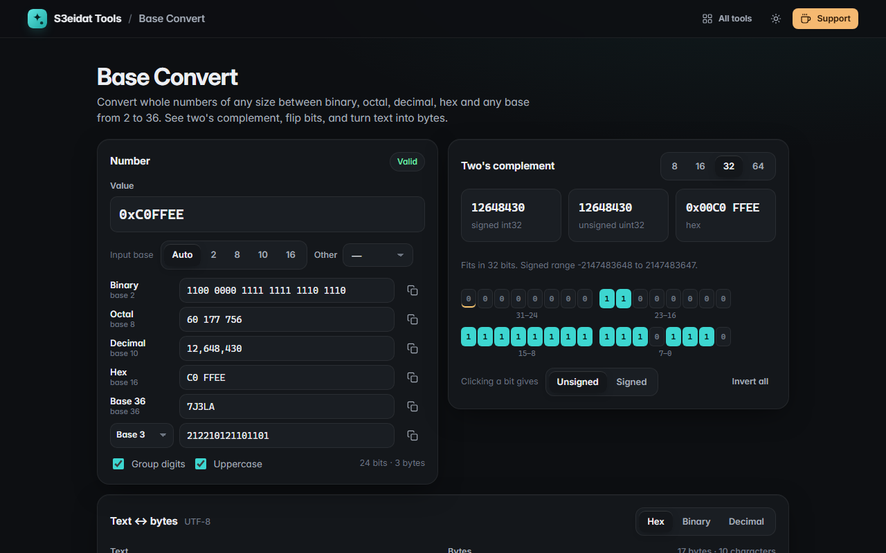

# Base Convert

> Convert numbers of any size between binary, octal, decimal, hex and any base from 2 to 36. Free, private, and it runs entirely in your browser.

### ▶ [Open Base Convert](https://s3eidat.github.io/base-convert/)



## Features

- **Arbitrary size**: uses JavaScript `BigInt`, so 2^100 or a 500-digit number converts exactly
- **Live conversion** between binary, octal, decimal, hex, base 36 and any base 2–36; type in any row
- Understands `0x`, `0b`, `0o` prefixes, negative numbers and `_`, space or comma separators
- **Two's complement** view for 8, 16, 32 and 64 bits: signed and unsigned values, hex, and a warning when the value wraps
- **Bit grid**: click any bit to flip it (sign bit marked), or invert all
- **Text ↔ bytes**: UTF-8 text to hex, binary or decimal bytes and back, with invalid UTF-8 detection
- Optional digit grouping and uppercase; copy buttons on every value

## Privacy

Nothing you type leaves your device. There is no server, no account, no analytics.
The page ships with a strict Content-Security-Policy (`connect-src 'self'`), so the browser
itself blocks any attempt to send data anywhere.

## Run it yourself

It's plain HTML, CSS and JavaScript with no build step:

```bash
git clone https://github.com/s3eidat/base-convert
cd base-convert
python -m http.server 8000
```

Then open http://localhost:8000.

## Support

If this saved you time, **[buy me a coffee ☕](https://s3eidat.github.io/coffee/)**. It keeps every tool free.

---

Part of **[S3eidat Tools](https://s3eidat.github.io/)**: 100+ free, private tools that run in your browser. MIT licensed.
